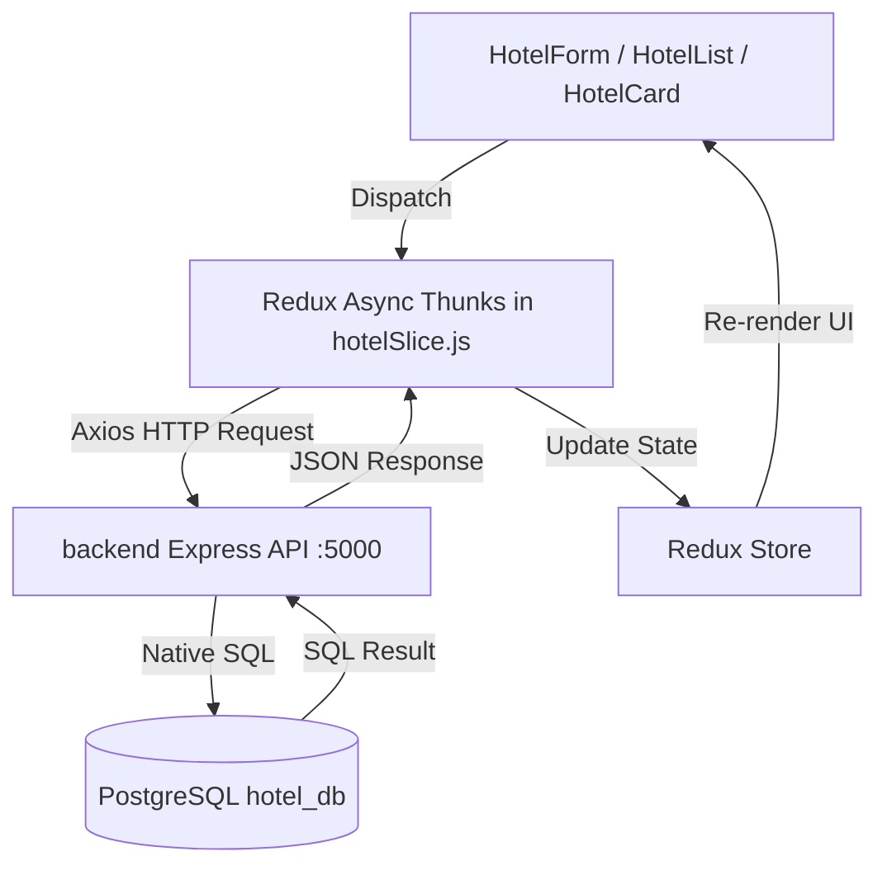

# Hotel Management Frontend (ReactJS + Redux)

A responsive, production-ready **Single Page Application (SPA)** built with **React 19**, **Redux Toolkit**, **Vite**, and **Leaflet**. Designed for discovering, browsing, filtering, and managing hotel property listings with real-time local file uploads, geolocation mapping, and dynamic SEO optimization.

---

## 🛠️ Technology Stack

- **Core Library:** React 19
- **Build Tool:** Vite (v8)
- **State Management:** Redux Toolkit (`@reduxjs/toolkit`) + `react-redux`
- **Routing:** React Router DOM (v7)
- **Map & Geolocation:** Leaflet (v1.9) + Browser Geolocation API
- **HTTP Client:** Axios (v1.20)
- **SEO & Meta Management:** `react-helmet-async` (Dynamic Title, Meta Tags, JSON-LD)
- **Icons:** Lucide React (`lucide-react`)
- **Styling:** Vanilla CSS with modern tokens, responsive grid/flex layouts, glassmorphism, and micro-animations

---

## ✨ Features

### 1. Reusable Add / Edit Form Component (`HotelForm.jsx`)
- **Single Reusable Component:** Serves both creating new listings and editing existing hotel details.
- **Image Upload with Preview:**
  - Local file picker with real-time client-side preview via `FileReader`.
  - Supports image URL input and preset sample luxury property photos.
  - Form validation for allowed MIME types (PNG, JPG, WebP) and file size (≤ 5MB).
- **Comprehensive Field Validation:**
  - **Title:** Text input (3 to 120 characters, required).
  - **Description:** Text area (15+ characters, required).
  - **Latitude & Longitude:** Location coordinates (-90 to 90, -180 to 180, required).
  - **Price:** Numeric input validating positive values greater than 0.
- **Geolocation API Integration:**
  - One-click **"Auto-Detect My Coordinates"** button that requests the browser's current GPS position via `navigator.geolocation.getCurrentPosition` and populates latitude and longitude fields.
  - Quick-preset buttons for popular destinations (Goa, Mumbai, Jaipur, Bengaluru, Ooty).

### 2. Hotel List Page with Filtering & Pagination (`HotelList.jsx`)
- **Card-Based List Display (Not a Table):** Responsive list and grid card layouts displaying hotel thumbnail, title, price (₹ formatting), coordinates tag, and short description snippet.
- **Search & Filter Features:**
  - **Title Search:** Real-time case-insensitive search (`ILIKE` matching).
  - **Price Range Filter:** Min and Max numeric inputs.
  - **Quick Price Presets:** One-click filter pills (*Under ₹3,000*, *₹3k–₹5k*, *₹5k–₹7k*, *₹7k+*).
  - **Sorting:** Sort by *Recommended*, *Price: Low to High*, *Price: High to Low*, or *Title (A–Z)*.
- **Dynamic Pagination (`Pagination.jsx`):**
  - Configurable page size (default 4 items per page).
  - First, Previous, numbered buttons, Next, and Last navigation with bounds safety.
- **Edit & Delete Actions:**
  - Dedicated **Edit** button on each card opens the pre-filled form.
  - **Delete** button triggers a safe confirmation modal ([`DeleteConfirmModal.jsx`](src/components/DeleteConfirmModal.jsx)).
  - Animated popup ([`SuccessPopup.jsx`](src/components/SuccessPopup.jsx)) confirms successful addition, edit, or deletion.

### 3. Hotel Detail Page with Interactive Map (`HotelDetails.jsx`)
- **Navigation:** Clicking any hotel card navigates seamlessly to `/hotels/:id`.
- **Full Property Showcase:** High-resolution hero image, badges, ratings, coordinates, full description, and curated amenities list.
- **Interactive Leaflet Map (`HotelMap.jsx`):**
  - Renders an OpenStreetMap container pinned at the hotel's exact latitude and longitude.
  - Custom branded marker pin with popup details (thumbnail, title, price, coordinates).
  - Live distance calculator using the browser Geolocation API and the Haversine formula (shows user's distance in km and estimated driving time).
  - Direct link to open location in Google Maps.

### 4. Search Engine Optimization (SEO) & Accessibility
- **Dynamic Meta Tags (`react-helmet-async`):**
  - Unique `<title>` and `<meta name="description">` on both the list and detail pages.
  - OpenGraph (`og:title`, `og:image`, `og:type`) and Twitter Cards (`twitter:card`, `twitter:title`).
  - Geographic meta tags (`geo.position`, `ICBM`).
  - **Schema.org JSON-LD Structured Data:** Generates `ItemList` on the list page and `Hotel` schema with `GeoCoordinates` on the detail page.
- **Accessibility:** All `` tags have descriptive `alt` tags and interactive controls have `aria-label` attributes.

---

## 📁 Project Architecture & Folder Structure

```
frontend/
├── public/                 # Static assets
├── src/
│   ├── assets/             # Brand logos & icons
│   ├── components/
│   │   ├── DeleteConfirmModal.jsx   # Safe deletion confirmation dialog
│   │   ├── DeleteConfirmModal.css
│   │   ├── Footer.jsx               # Global footer with links
│   │   ├── Footer.css
│   │   ├── HotelCard.jsx            # Reusable card component for list items
│   │   ├── HotelCard.css
│   │   ├── HotelForm.jsx            # Reusable Add & Edit form with file preview & geo-detect
│   │   ├── HotelForm.css
│   │   ├── HotelMap.jsx             # Interactive Leaflet map with user distance
│   │   ├── HotelMap.css
│   │   ├── LoginModal.jsx           # Guest login modal
│   │   ├── LoginModal.css
│   │   ├── Navbar.jsx               # Header navigation & quick-actions
│   │   ├── Navbar.css
│   │   ├── Pagination.jsx           # Reusable pagination control
│   │   ├── Pagination.css
│   │   ├── SuccessPopup.jsx         # Action success notification
│   │   └── SuccessPopup.css
│   ├── pages/
│   │   ├── HotelDetails.jsx         # Detail view with interactive map & booking box
│   │   ├── HotelDetails.css
│   │   ├── HotelList.jsx            # Main list page with search, filters & pagination
│   │   └── HotelList.css
│   ├── redux/
│   │   ├── hotelSlice.js            # Redux Toolkit slice with async thunks for API CRUD
│   │   └── store.js                 # Central Redux store configuration
│   ├── services/
│   │   └── hotelApi.js              # Axios service connecting to Express backend
│   ├── App.jsx                      # React Router configuration (SPA root)
│   ├── App.css
│   ├── index.css                    # Design system tokens, variables & typography
│   └── main.jsx                     # Redux Provider & HelmetProvider mounting
├── index.html                       # HTML5 entry with SEO tags & Google Fonts
├── package.json
└── vite.config.js
```

---

## 🚀 Getting Started

### 1. Prerequisites
- **Node.js:** v18.0.0 or higher
- **npm:** v9.0.0 or higher
- **Backend API:** Running on `http://localhost:5000` (see `backend/README.md`)

### 2. Installation
Open a terminal in the `frontend` folder:
```bash
cd frontend
npm install
```

### 3. Environment Variables (Optional)
By default, the application connects to the local backend at `http://localhost:5000`. To customize, create a `.env` file in `frontend/`:

```env
VITE_API_URL=http://localhost:5000
```

### 4. Running the Development Server
```bash
npm run dev
```
Open **[http://localhost:5173](http://localhost:5173)** in your browser.

---

## 📜 Available Scripts

| Command | Description |
| :--- | :--- |
| `npm run dev` | Starts Vite dev server with Hot Module Replacement (HMR) on port `5173` |
| `npm run build` | Compiles and bundles production-ready static assets into `dist/` |
| `npm run preview` | Locally serves the production bundle from `dist/` |
| `npm run lint` | Runs `oxlint` for high-speed code quality checks |

---

## 🔗 Redux State & Backend API Flow



- When the application mounts, `fetchHotelsAsync` requests `GET /api/hotels`.
- When adding a hotel with an uploaded file, `addHotelAsync` builds a `FormData` payload and posts to `POST /api/hotels`. The server stores the image in `backend/uploads/` and inserts the record into PostgreSQL.
- Images with relative paths (e.g. `/uploads/hotel-...jpg`) are resolved to full URLs via `getImageUrl()` in `src/services/hotelApi.js`.
- If the backend is temporarily offline, the frontend gracefully falls back to local storage so the interface never crashes.
